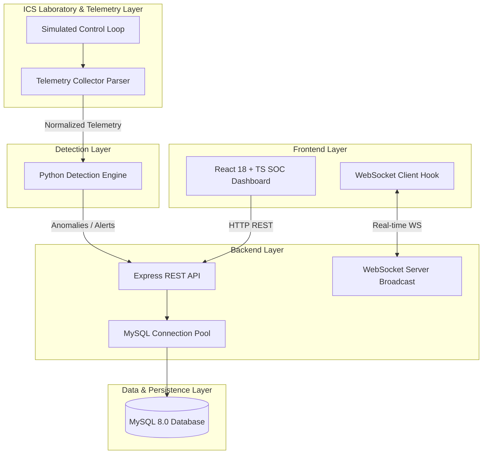

# ICS-SHIELD System Architecture & Technical Overview

## 1. Executive Summary
**ICS-SHIELD** is a defensive cybersecurity and real-time SCADA / Industrial Control System attack detection platform built for laboratory research, threat simulation, and SOC incident triage.

---

## 2. High-Level System Architecture

---

## 3. Core Subsystems

### 3.1 Frontend Subsystem
- **Technology**: React 18, TypeScript, Vite, Tailwind CSS.
- **Design System**: SOC dark charcoal palette (`#090d16`), deep navy panels (`#131c2e`), cyan telemetry indicators (`#38bdf8`), Inter font for UI text, and JetBrains Mono for monospace data (IPs, Ports, Device IDs, Log Payloads).
- **Routing**: 15 modular routes (`/dashboard`, `/assets`, `/network`, `/topology`, `/process`, `/alerts`, `/incidents`, `/detection`, `/mitre`, `/simulation`, `/response`, `/reports`, `/admin`, `/settings`, `/login`).

### 3.2 Backend REST API & WebSocket Subsystem
- **Technology**: Node.js, Express.js (ES Modules), `ws` WebSocket library.
- **Health Endpoint**: `GET /api/health` providing structured component status.
- **WebSocket Feed**: Real-time push feed for packet rates, active alerts count, and system state ticks.

### 3.3 Database Foundation
- **RDBMS**: MySQL 8.0.
- **Schema**: Managed under `database/schema/001_initial_schema.sql` tracking assets, alerts, incidents, and health logs.
- **Migration Framework**: `database/migrations/migrate.js`.

### 3.4 Python Detection Engine
- **Technology**: Python 3.11, FastAPI, Uvicorn.
- **Role**: Decoupled ML baseline anomaly detection microservice evaluating telemetry frames for Modbus TCP, DNP3, and S7comm protocol anomalies.

### 3.5 Telemetry Collector & Pipeline
- Decoupled ingestion layer parsing network frames into normalized JSON events before dispatching to the detection engine.

### 3.6 ICS Laboratory Environment
- Isolated lab environment modeling Purdue Level 0 to Level 3 industrial control loops (Water Filtration, Feeder Substation, Chemical Dosing).

### 3.7 Response Engine
- Operator decision-support module providing MITRE ATT&CK for ICS (v14) recommendations and firewall ACL playbooks.

---

## 4. Inter-Service Communication Paths

1. **Frontend ↔ Backend**: REST API (`http://localhost:5000/api`) + WebSockets (`ws://localhost:5001`).
2. **Backend ↔ Detection Engine**: Asynchronous HTTP/gRPC API (`http://detection-engine:8000`).
3. **Backend ↔ Database**: Connection pool via `mysql2/promise`.
4. **Telemetry Collector ↔ Detection Engine**: Direct queue/stream buffer.
