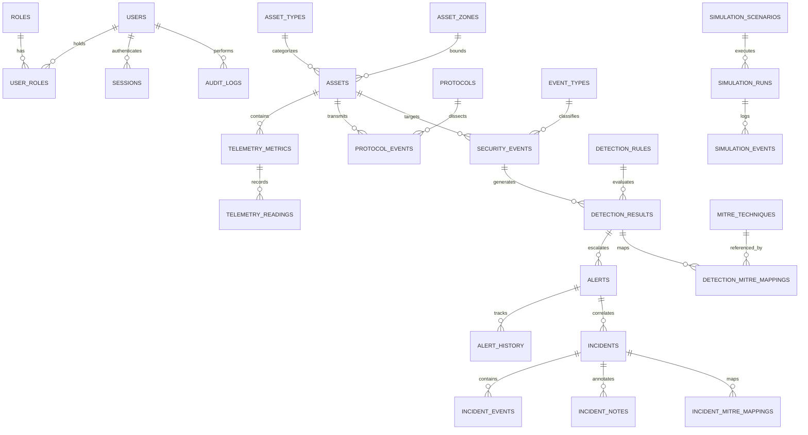

# ICS-SHIELD Database Architecture & Data Model (Phase 2)

## 1. Executive Summary
The **ICS-SHIELD** database subsystem provides a normalized, high-performance relational foundation for SCADA telemetry, industrial asset tracking, MITRE ATT&CK for ICS (v14) mappings, anomaly detection, alert triage, incident case management, attack simulation, and audit logging.

---

## 2. Mermaid Entity-Relationship (ER) Diagram

---

## 3. Core Design Strategies

### 3.1 Identifier & UUID Strategy
- **Internal Auto-Increment Primary Keys (`BIGINT` / `INT`)**: Used internally for high-performance joins, foreign key lookups, and index optimization.
- **External UUIDs (`asset_uuid`, `alert_uuid`, `event_uuid`)**: Exposed to external REST APIs and WebSockets to prevent predictable sequential resource enumeration.

### 3.2 UTC Timestamping Strategy
- All temporal fields (`timestamp`, `created_at`, `updated_at`, `resolved_at`) store timestamps in **Coordinated Universal Time (UTC)** using `DATETIME(3)` (millisecond accuracy) or `DATETIME`.
- The frontend SOC application parses UTC timestamps and formats them according to the operator's configured timezone.

### 3.3 High-Volume Telemetry & Data Retention Strategy
- **Indexing**: Compound index on `(metric_id, timestamp)` for fast range scans over telemetry sensor readings.
- **Partitioning Preparedness**: Table structures (`telemetry_readings`, `protocol_events`) are partitioned by timestamp range (`RANGE (YEAR(timestamp))`) for future automated archival without locking live tables.
- **Retention**: Configurable setting `telemetry_retention_days` (default: 30 days) and `alert_retention_days` (default: 90 days).

---

## 4. Table Groups Summary (15 Modules)

| Group | Key Tables | Purpose |
| :--- | :--- | :--- |
| **1. Identity & Access** | `users`, `roles`, `permissions`, `user_roles`, `sessions` | RBAC authentication, user sessions, bcrypt password hashes. |
| **2. ICS Assets** | `assets`, `asset_types`, `asset_zones`, `asset_interfaces` | Industrial controller inventory (PLCs, RTUs, HMIs, SCADA servers). |
| **3. Network & Topology** | `network_zones`, `network_segments`, `asset_relationships` | Purdue Model levels (0..4), zone boundaries, master-slave linkages. |
| **4. Protocols** | `protocols`, `protocol_sessions`, `protocol_events` | SCADA packet headers (Modbus TCP, DNP3, OPC UA, S7, EtherNet/IP). |
| **5. Telemetry** | `telemetry_metrics`, `telemetry_readings` | Physical process metrics (pressure, temp, flow, voltage, state). |
| **6. Security Events** | `security_events`, `event_types`, `event_severity` | Categorized security anomalies and raw evidence payloads. |
| **7. Detection Engine** | `detection_rules`, `detection_results` | Rule-based, ML, statistical, and correlation detection outputs. |
| **8. Machine Learning** | `ml_models`, `ml_model_versions`, `ml_predictions` | Model registry, accuracy metrics, and inference predictions. |
| **9. Alert Management** | `alerts`, `alert_statuses`, `alert_history` | Triage workflow (NEW, ACKNOWLEDGED, ESCALATED, RESOLVED). |
| **10. Incidents** | `incidents`, `incident_events`, `incident_evidence` | Formal case investigation lifecycle and forensic evidence. |
| **11. MITRE ATT&CK** | `mitre_tactics`, `mitre_techniques`, `mappings` | ATT&CK for ICS v14 technique correlations (e.g. T0855). |
| **12. Response** | `response_playbooks`, `response_actions` | Non-destructive operator playbooks and simulated ACL rules. |
| **13. Simulation** | `simulation_scenarios`, `simulation_runs` | Synthetic laboratory attack scenario execution logs. |
| **14. Audit Logs** | `audit_logs` | Immutable audit trail for login, alert acknowledge, and rule edits. |
| **15. Settings** | `system_settings` | Global non-sensitive platform configurations. |

---

## 5. Security & Privacy Considerations
- **No Plaintext Passwords**: User passwords hashed using strong salt (`bcrypt`/`argon2`).
- **No Secret Storage**: API secrets, database passwords, and JWT keys are strictly excluded from tables and seed scripts.
- **Sanitized Client Errors**: Backend API suppresses internal SQL tracebacks in HTTP responses and logs full error stacks server-side.
